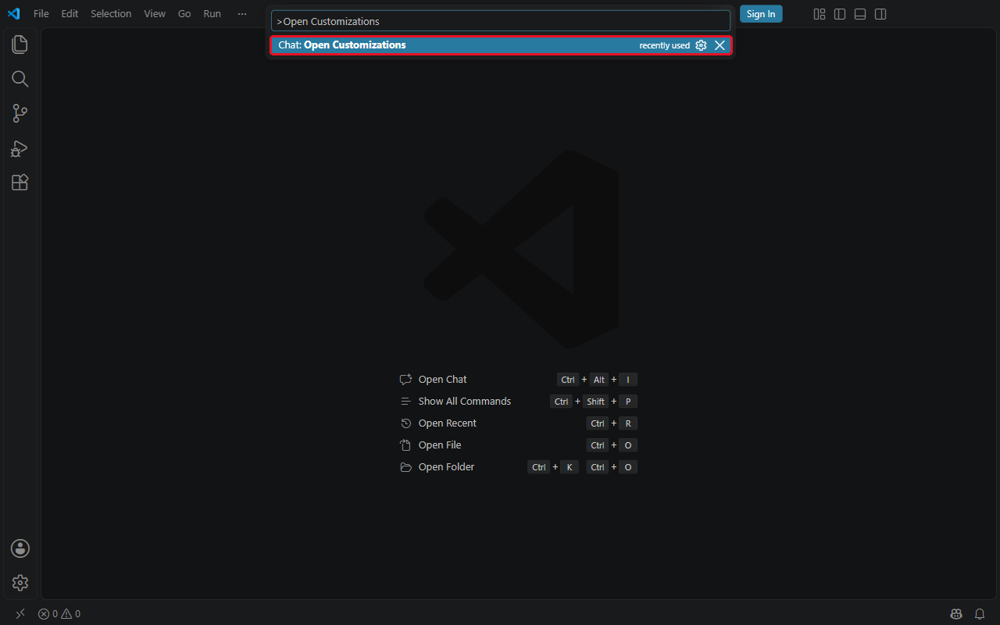
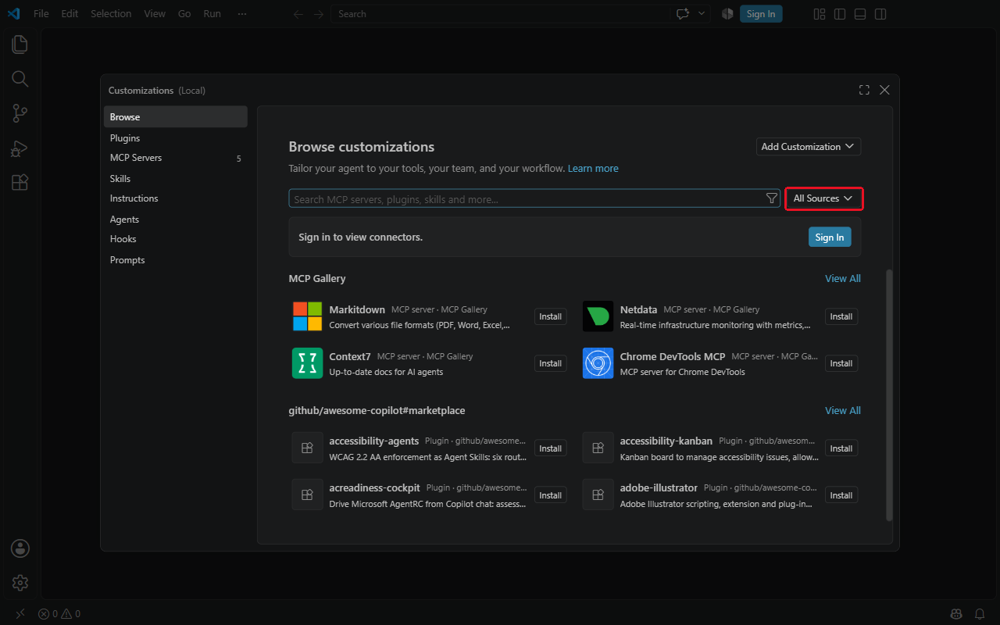
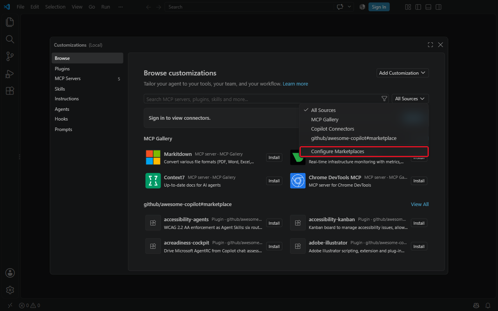
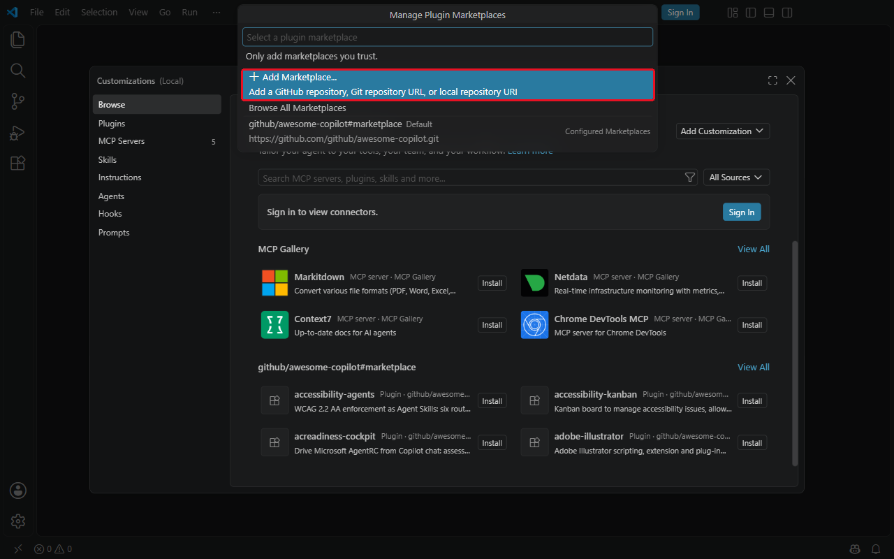
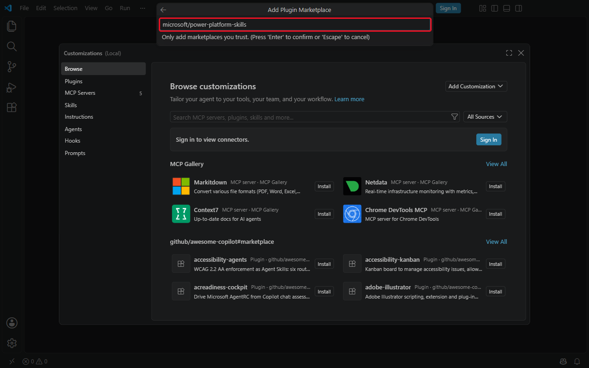
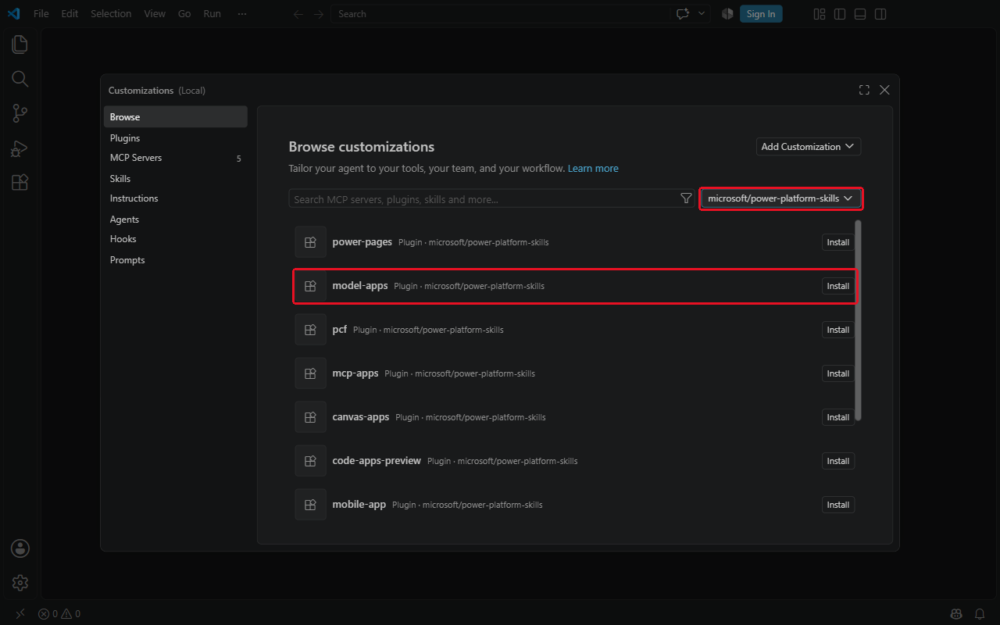
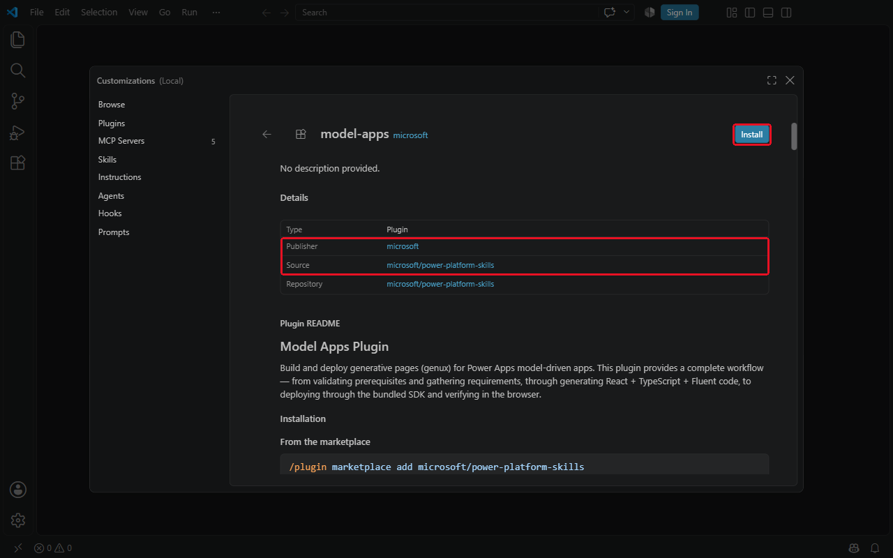
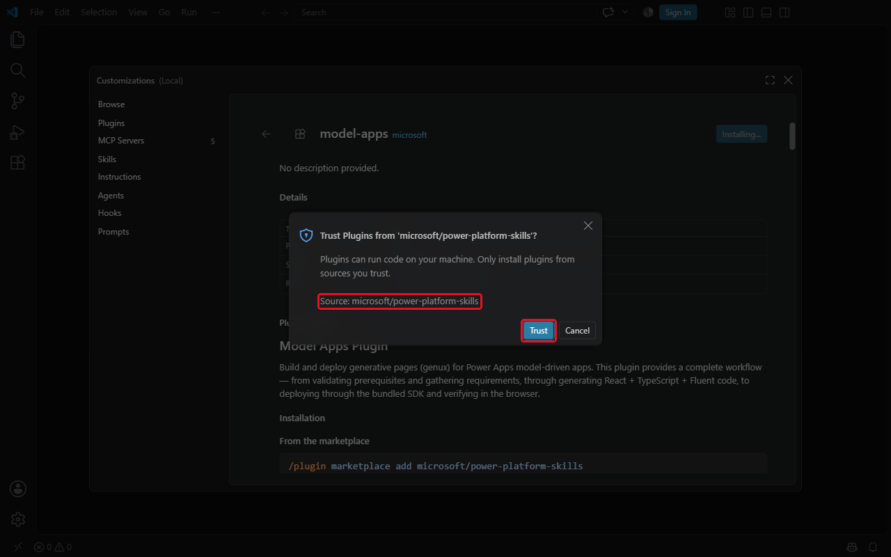
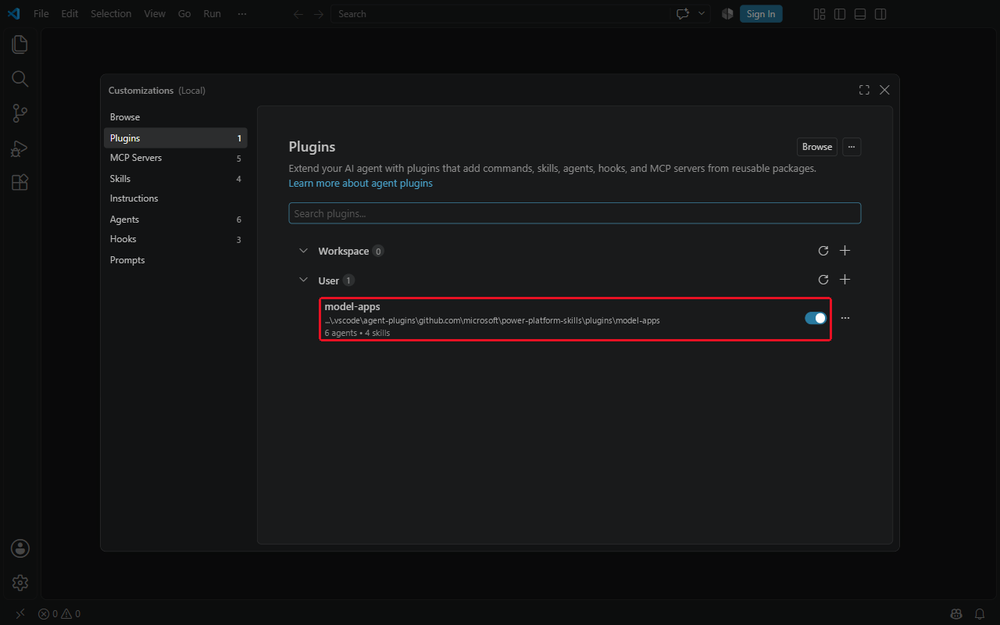

# Lab 1 — Add a marketplace and install Power Platform plugins

**Time:** 15 minutes  
**Goal:** add Microsoft's Power Platform plugin marketplace, find out what a plugin contains **before** you install it, and then install it.  

## Words used in this lab

- **Plugin:** a package of AI customizations (agents, skills, instructions and MCP servers) that you install in one go. It is different from a VS Code *extension* such as Power Platform Tools.
- **Marketplace:** a GitHub repository that lists plugins. Adding a marketplace only lets you browse it; nothing is installed yet.

## Before you start

- VS Code is open, and you are signed in to GitHub Copilot (Lab 0).
- You do everything in this lab with mouse clicks in VS Code. The plugin website also offers an “Install everything at once” terminal command; skip it today. It installs all Microsoft's plugins for other tools (GitHub Copilot CLI and Claude Code), not just the one we need.

The screenshots are from VS Code 1.146 on Windows. Yours may look slightly different, and on macOS the shortcuts use **Cmd** instead of **Ctrl**. The red boxes show what to select.

## Part A — Open the Agent Customizations editor

1. Open the Command Palette: **Ctrl+Shift+P** (Windows) or **Cmd+Shift+P** (macOS).
2. Type `Open Customizations` and select **Chat: Open Customizations**.

   

   - Alternative: open the Chat view (**Ctrl+Alt+I** / **Ctrl+Cmd+I**) and select **Open Customizations** in the Chat view's title bar.
3. The **Customizations** window opens on top of the editor. On the left are sections such as **Browse**, **Plugins**, **MCP Servers**, **Skills**, **Instructions** and **Agents**.

## Part B — Add the Power Platform marketplace

1. In the Customizations window, select **Browse**. The **source menu** is the drop-down next to the search box; it shows **All Sources**.

   

2. Open the source menu and select **Configure Marketplaces**.

   

3. Select **Add Marketplace...**.

   

4. Type exactly `microsoft/power-platform-skills` and press **Enter**. Adding a marketplace does not install anything.

   

5. Open the source menu again and select **microsoft/power-platform-skills**.

You now see Microsoft's Power Platform plugins, for example *model-apps*, *canvas-apps*, *power-pages*, *pcf* and *code-apps-preview*.



**If your VS Code has no Browse page** (the feature is in preview):

1. Select **Plugins** and then **Browse Marketplace**.
2. If **power-platform-skills** is not listed, open **Settings** (**Ctrl+,** / **Cmd+,**) and search for `chat.plugins.marketplaces`.
3. Select **Edit in settings.json**. VS Code opens your settings file with the setting added. Make it look like this, keeping any other settings and existing entries:

   ```json
   "chat.plugins.marketplaces": ["microsoft/power-platform-skills"]
   ```

4. Save the file (**Ctrl+S** / **Cmd+S**), go back to **Plugins → Browse Marketplace** and look for the Power Platform plugins.

## Part C — Install model-apps

1. Select **model-apps** in the list (the name, not the **Install** button). Its details page shows the publisher (**microsoft**), the source and a README that describes what it adds. Take a quick look before installing; plugins can run code on your computer.

   

2. Select **Install**.
3. VS Code asks *“Trust Plugins from 'microsoft/power-platform-skills'?”*. Check that the source says **microsoft/power-platform-skills** and select **Trust**. The button changes to **Installed**.

   

4. Select **Plugins** in the left menu. **model-apps** is listed under **User**, which means it is available in all your workspaces, and its switch is **on**.

   
5. Optional: install **canvas-apps** the same way if you work with Canvas Apps.

## Part D — Ask GitHub Copilot what you got

Open the Chat view, start a **new chat** with the **+** button, and ask:

> List the Power Platform customizations that the model-apps plugin added. Group them by agent, skill and MCP server, and say in one line when I would use each. Do not call any tools.

Then type `/` in the chat box: the plugin's skills appear as slash commands. If nothing appears, check that you are signed in to GitHub (the **Accounts** icon at the bottom left).

## Optional — Copilot Studio plugin (only for optional Lab 6)

Do this only if you have a **Copilot Studio licence** and want to build a Copilot Studio agent from VS Code in optional Lab 6. Everyone else can skip it.

Repeat **Part B** with the marketplace `microsoft/copilot-studio-plugin`, then install the **mcs-assistant** plugin as in Part C.

## Done when

**model-apps** is listed as installed and enabled under **Plugins**, and you can name at least two of its skills.

## Removing or turning off a plugin

**Plugins** → turn off the plugin's switch (to disable it), or select **...** next to it and **Uninstall** (to remove it).

## Troubleshooting

- **No Plugins or Browse section:** update VS Code (**Help → Check for Updates** on Windows, **Code → Check for Updates** on macOS). Then open **Settings**, search for `chat.plugins.enabled` and tick it. If it is locked and says *managed by your organization*, your company has turned plugins off: pair with a neighbour for the rest of the lab.
- **Marketplace not found:** check the spelling `microsoft/power-platform-skills`, with no spaces or `https://`. Then select **Refresh Marketplace** in **Configure Marketplaces**.
- **The plugin installs but its skills do not appear:** open **Plugins**, check that the plugin is **enabled**, and start a **new** chat.
- **A server asks you to sign in:** follow the sign-in prompt. Lab 2 explains the Dataverse account and environment settings.
