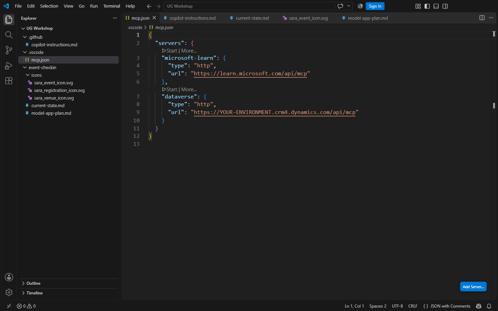
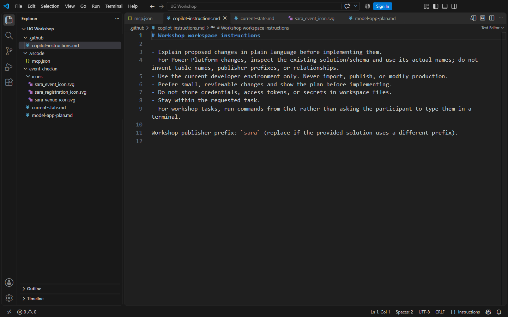

# Lab 2 — Your workspace: connect GitHub Copilot to your environment

**Time:** 35 minutes
**Goal:** set up a workspace folder where GitHub Copilot can look up Microsoft documentation, read your Dataverse environment and use the Power Platform plugins from Lab 1.

## What you will have after this lab

| You set up | What it gives you |
|---|---|
| A workspace folder: `UG Workshop` | One place for everything you build today. GitHub Copilot uses what is in this folder as context. |
| Two MCP servers in `.vscode/mcp.json` | **Microsoft Learn**: up-to-date Microsoft documentation. **Dataverse**: GitHub Copilot can read tables and data in your environment. |
| PAC CLI and Azure CLI signed in | The Power Platform plugins from Lab 1, for example *model-apps*, use these sign-ins to work against your environment in Labs 3 and 4. |

You need your environment's **Instance URL** from Lab 0, for example `https://contoso-dev.crm4.dynamics.com`.

## Part A — Create and open your workspace folder (5 min)

1. Open **File Explorer** (Windows) or **Finder** (macOS).
2. Create the folder:
   - **Windows:** go to **This PC → Local Disk (C:)**, create a folder named `Repos`, and inside it a folder named `UG Workshop`. The result is `C:\Repos\UG Workshop`.
   - **macOS:** go to your home folder (the house icon), create a folder named `Repos`, and inside it a folder named `UG Workshop`.

   If `Repos` already exists, create only `UG Workshop` inside it.
3. In VS Code, select **File → Open Folder…** (Windows) or **File → Open…** (macOS), select `UG Workshop` and then **Select Folder** (Windows) or **Open** (macOS).
4. If VS Code asks whether you trust the authors of the files in this folder, select **Yes, I trust the authors**. It is your own empty folder.
5. Check that the Explorer view shows **UG WORKSHOP** at the top.

From now on, every lab is done in this folder.

## Part B — Add the workshop's MCP servers (10 min)

An MCP server gives GitHub Copilot tools. You configure this workspace's servers in `.vscode/mcp.json`. Use the JSON below; there is no separate starter file to download.

### First: allow GitHub Copilot in your Dataverse environment

Signing in proves who you are; it does **not** enable an MCP client. Dataverse MCP allows Copilot Studio by default, but **Microsoft GitHub Copilot** must be enabled separately in each environment. This is why a successful browser sign-in can still end with a connection error.

If this was completed in Lab 0, go straight to **Create the configuration** below. Otherwise, a **Power Platform administrator** needs to:

1. Open the [Power Platform admin center](https://admin.powerplatform.microsoft.com/).
2. Select **Manage → Environments** and select your workshop environment.
3. Open **Settings → Product → Features**.
4. Find **Dataverse Model Context Protocol** and turn on **Allow MCP clients to interact with Dataverse MCP server**.
5. Select **Advanced Settings** and open the **Microsoft GitHub Copilot** client record.
6. Set **Is Enabled** to **Yes**, then select **Save & Close**.

If you do not have that administrator role, send these steps and your environment name to your administrator. Your Dataverse security roles still determine which tables and records you can access after the client is enabled.

Source: [Microsoft's Dataverse MCP configuration guide](https://learn.microsoft.com/power-apps/maker/data-platform/data-platform-mcp-disable#configure-and-manage-the-dataverse-mcp-server).

### Create the configuration

1. Copy this JSON:

   ```json
   {
     "servers": {
       "microsoft-learn": {
         "type": "http",
         "url": "https://learn.microsoft.com/api/mcp"
       },
       "dataverse": {
         "type": "http",
         "url": "https://YOUR-ENVIRONMENT.crm4.dynamics.com/api/mcp"
       }
     }
   }
   ```

2. Open GitHub Copilot Chat (**Ctrl+Alt+I** on Windows, **Ctrl+Cmd+I** on macOS) and select **Agent** in the mode picker.
3. Type the message below, replace `<your Instance URL>` with your own, and paste the JSON at the end:

   > These are the MCP servers I want to use in this workspace. Create `.vscode/mcp.json` with exactly this content, but replace `https://YOUR-ENVIRONMENT.crm4.dynamics.com` with `<your Instance URL>` (without a slash at the end). Do not add any other servers or settings.

4. GitHub Copilot creates the file and shows it under the Chat message with **Keep** and **Undo**. Open the file and check that:
   - there are exactly two servers, `microsoft-learn` and `dataverse`;
   - the Dataverse address is **your workshop environment** followed by `/api/mcp`;
   - there are no passwords, keys or tokens.

   Then select **Keep**.

   

   This example uses a placeholder environment URL and shows the servers before they are started.

5. In `mcp.json`, select **Start** above `microsoft-learn` and follow any trust prompt. The text above the server changes to **Running** and shows how many tools it has.
6. Select **Start** above `dataverse`. When prompted, sign in with your **work or school account** for Power Apps, not your GitHub account. Check that it also shows **Running**. If it fails after sign-in, use the troubleshooting table below to distinguish a client setting from an account or permissions problem.
7. In Chat, select the **Configure Tools** button (the tools icon next to the model picker). Find **microsoft-learn** and **dataverse** in the list and expand them to see their tools. Close the list.

> **Keep or Undo?** Every time GitHub Copilot changes a file, the change waits for you in Chat. **Keep** accepts it and **Undo** removes it. You will do this all day: read first, then decide.

If your administrator cannot enable Dataverse MCP during the workshop, you can still complete Microsoft Learn setup and the CLI sign-ins. The facilitator can demonstrate the Dataverse question in Part D.

## Part C — Sign in to your environment from Chat (10 min)

The Power Platform plugins use two command-line tools in the background: **PAC CLI** (Power Platform CLI, part of Power Platform Tools) and **Azure CLI**. GitHub Copilot runs the sign-in commands; you complete the sign-in windows.

These are separate connections:

| Connection | Account and purpose |
|---|---|
| GitHub Copilot in VS Code | Your **GitHub account** provides your Copilot licence. |
| Dataverse MCP | Your **Power Apps work account** connects the MCP server to Dataverse. |
| PAC CLI and Azure CLI | The **same Power Apps work account** lets plugin skills use CLI commands and the Dataverse Web API. Signing in to MCP does not sign in these tools. |

### Steps

1. In Chat (still **Agent** mode), type:

   > Connect to my Power Platform environment `<your Instance URL>`. Sign in PAC CLI with `pac auth create --environment <your Instance URL>`, then sign in Azure CLI with `az login --allow-no-subscriptions` using the same work account and tenant. Check both with `pac org who` and `az account show`, and summarise the environment URL, account and tenant.

2. Complete the PAC CLI sign-in with your **work or school account**, the same one you use in Power Apps. Return to VS Code.
3. Complete the Azure CLI sign-in with the **same account and tenant**.
4. GitHub Copilot checks the sign-ins and reports your environment name, URL and the account each tool uses.
5. Check that:
   - the environment is your **workshop** environment, not production;
   - **PAC CLI and Azure CLI use the same account**. If they differ, ask GitHub Copilot to sign in to Azure CLI again with the right account.

## Part D — Try it (10 min)

Ask one question at a time in **Agent** mode. Under each answer, expand the tool calls to see which server or command GitHub Copilot used.

1. Microsoft documentation:

   > Using Microsoft Learn, explain the difference between a managed and an unmanaged solution in three sentences. Include the link you used.

2. Your environment:

   > Using Dataverse MCP, which environment am I connected to, and which custom tables are in it? Show display name and logical name. Only read; do not create, change or delete anything.

3. Your plugins:

   > I installed Microsoft's model-apps plugin. Is its app-builder skill available in this chat? Check my current PAC CLI environment and Azure CLI account and tenant, and report any missing sign-in needed to use it with `<your Instance URL>`. Do not run app-builder or change anything in the environment.

   Replace `<your Instance URL>` with your own. A new chat does not remember Lab 1: the prompt names the plugin, and VS Code makes enabled skills available to the chat. For the actual installed-plugin list, use **Chat: Open Customizations → Plugins**; type `/` in Chat to look for **/model-apps:app-builder**. Skill availability and environment sign-in are separate checks, not proof that every operation will succeed.

## Done when

- [ ] VS Code has `UG Workshop` open.
- [ ] `.vscode/mcp.json` contains Microsoft Learn and Dataverse (or Dataverse is stopped because it is blocked), and you selected **Keep**.
- [ ] PAC CLI and Azure CLI are signed in to your workshop environment with the same account.
- [ ] GitHub Copilot has answered at least one question with data from your environment.

## Extra — Give GitHub Copilot project context (if you have time)

**Copilot instructions** are a Markdown file with reusable project guidance. Instead of repeating “our publisher prefix is `sara`” or “use the existing table names” in every prompt, you write it once in `.github/copilot-instructions.md`. VS Code automatically includes that file in Copilot chats for the open workspace.

**“Rules in this workspace”** means that written guidance for this project, not settings on your computer or permissions in Dataverse. Instructions guide the model; they are not security controls and do not grant access to an environment.

For example, the workshop instructions tell GitHub Copilot to inspect the existing schema, use the workshop's publisher prefix and keep changes small. The starter file is a template: simply leaving it in `starter` does not activate it in your `UG Workshop` folder.

1. Open [`starter/copilot-instructions.md`](../starter/copilot-instructions.md) in the workshop repository and copy its contents.
2. In Chat, ask:

   > Create `.github/copilot-instructions.md` in this workspace with exactly this content: (paste the contents)

3. Read the file, select **Keep**, and then start a new chat with the **+** button.

   

4. Open **Chat: Open Customizations → Instructions** and check that the workspace file is listed.
5. Ask: *“Based on this workspace's instructions, which publisher prefix should a new workshop table use, and how should you find existing table names? Do not create anything.”* Check that the answer mentions `sara` and inspecting the actual schema. Where available, expand the answer's **References** to see the instructions file.

This is the **Instructions** building block from the “What belongs where?” slide. In Lab 5 you add a different kind of customization: an **agent** for a role and a **skill** for reusable expertise.

More: [Custom instructions in VS Code](https://code.visualstudio.com/docs/agent-customization/custom-instructions). The [starter-file guide](../README.md#which-starter-files-do-i-need) explains what to copy for each lab; you do not need the whole starter folder.

## Troubleshooting

| Problem | What to do |
|---|---|
| GitHub Copilot shows the command but nothing runs | Check that **Agent** mode is selected and look in Chat for the **Allow** button. |
| `pac` is not recognised | Check that Power Platform Tools is installed (Lab 0, section 4). Restart VS Code and ask GitHub Copilot to try again. |
| `az` is not recognised | Azure CLI is not installed or VS Code was open during the installation (Lab 0, section 3). Restart VS Code and ask GitHub Copilot to try again. |
| `az login` waits for input with a list of subscriptions or tenants | Choose the tenant that contains your workshop environment. An Azure subscription is not required for this workshop; the prompt uses `--allow-no-subscriptions`. |
| PAC CLI and Azure CLI show different accounts | Ask GitHub Copilot to sign out of Azure CLI and sign in again with the account that PAC CLI uses. |
| An MCP server does not start | Open the server's error/output from `mcp.json` to read the full message. Check that the URL is your Instance URL followed by `/api/mcp`, with no doubled slash. Microsoft Learn does not need a sign-in. |
| Browser sign-in succeeds, but Dataverse says the client is not allowed | Authentication worked, but the environment has not allowed this MCP client. Have a Power Platform administrator complete **Part B → First: allow GitHub Copilot**, including **Is Enabled → Yes → Save & Close** on the **Microsoft GitHub Copilot** record. Then stop and start the Dataverse server and retry. PAC CLI or Azure CLI sign-in cannot fix this setting. |
| Dataverse returns *401* or asks you to sign in again | The sign-in may have expired or used the wrong account/tenant. Restart the server and complete authentication with the Power Apps account and tenant for this environment. |
| Dataverse returns *403* or *access denied* | Read the full error. A “client not allowed” message needs the admin setting above; other access errors can mean your user lacks environment access or the required Dataverse security role. Give the administrator the error and environment URL. |
| The browser says *admin approval required* or reports a Conditional Access policy | This is an Entra tenant consent or access policy, not the Dataverse client switch. Send the error to your administrator; changing `mcp.json` will not resolve that policy. |
| `app-builder` is not available in the new chat | Check that **model-apps** is installed and enabled in **Chat: Open Customizations → Plugins**, then start a new chat. |
| GitHub Copilot answers without using a tool | Check **Agent** mode, check that the server is **Running**, and name the server in your question, for example *“Using Dataverse MCP, …”*. |