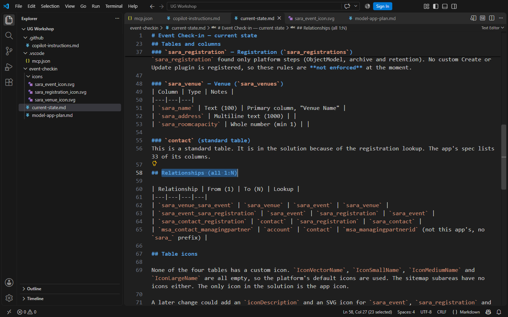
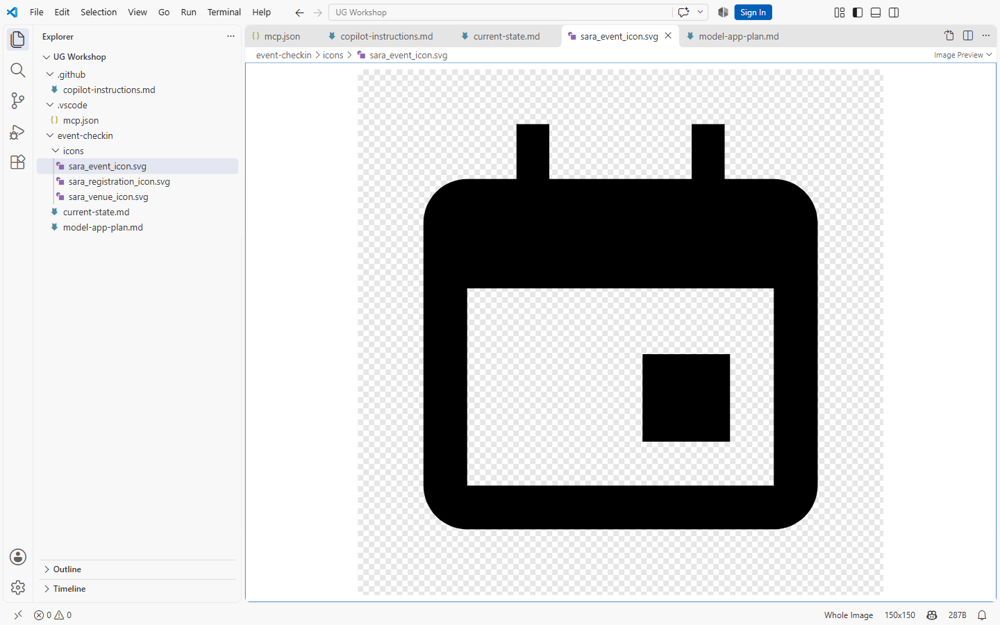
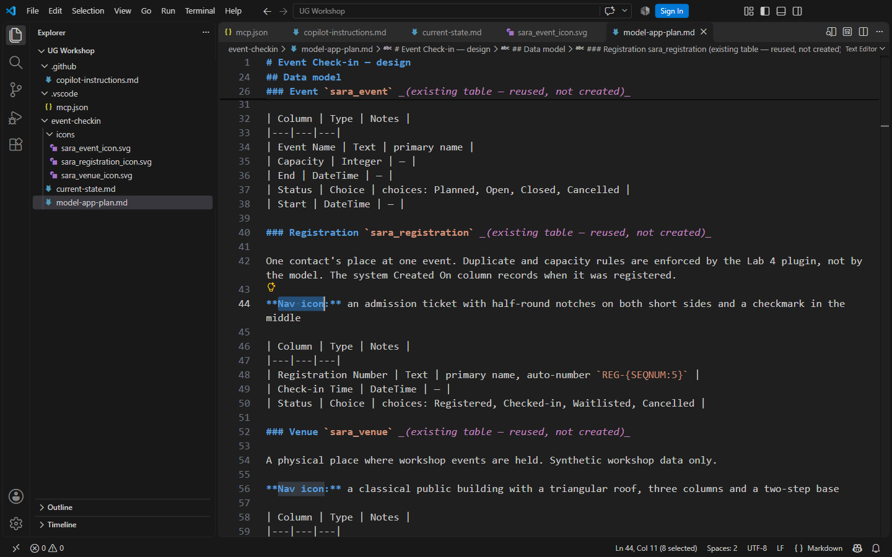
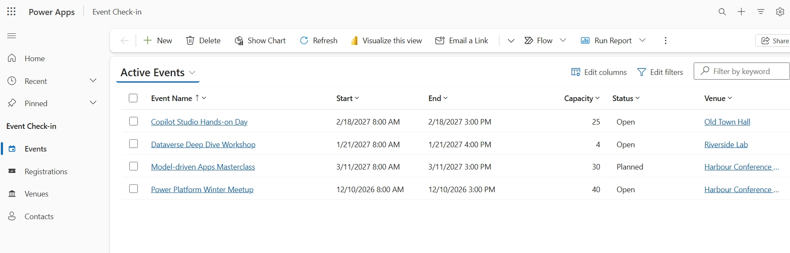
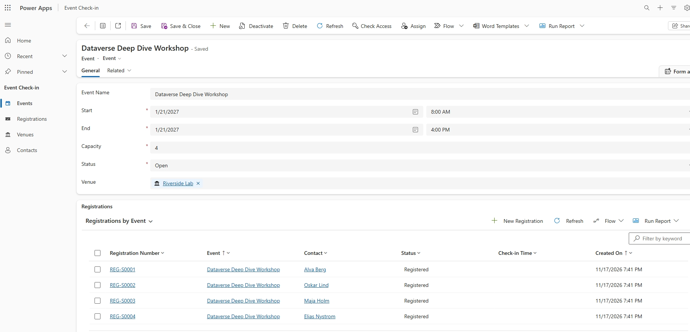

# Lab 3 — Improve the Event Check-in app with the app-builder skill

**Time:** 50 minutes  
**Goal:** use a plugin you installed in Lab 1 — Microsoft's **model-apps** plugin and its `/model-apps:app-builder` skill — to improve a model-driven app that is already deployed: give its tables proper icons and fill it with sample data. You describe the change, GitHub Copilot plans it, and nothing changes in your environment until you approve the plan.

## What you will have after this lab

| You do | What it gives you |
|---|---|
| Import the Event Check-in solution | A working model-driven app with the tables **Event**, **Venue** and **Registration** — still with the default table icons and no data. |
| Ask `/model-apps:app-builder` to inspect the app | A readable summary of the existing app in `event-checkin/current-state.md`. |
| Ask for icons and sample data | A change plan in `event-checkin/model-app-plan.md`, including the cases Lab 4 needs. |
| Approve the plan and apply it | Fluent-style table icons and realistic test data applied to your environment, with the customizations in the Event Check-in solution and the result verified. |

> **What you learn:** how an installed skill turns GitHub Copilot into a specialist. `/model-apps:app-builder` knows how Microsoft wants model-driven apps built: icons on every table, changes inside your solution, a dry run before anything is written and a check afterwards. You do not have to know the Web API calls behind it; you have to review what it plans.

## Before you start

- Keep the `UG Workshop` folder from Lab 2 open in VS Code, with Azure CLI and Power Platform CLI signed in to your workshop **developer** environment.
- `/model-apps:app-builder` writes its files in the workspace. That is expected; you review them before anything is applied.
- Choose a capable model in the model picker under the Chat input box. The model-apps plugin recommends against lightweight models for this skill.

## Part A — Import the solution (8 min)

1. Download [`EventCheckIn_1_0_0_0.zip`](https://github.com/LagerquistSara/AIDevWS/raw/main/starter/EventCheckIn_1_0_0_0.zip) from the workshop repository. Save it anywhere except inside `UG Workshop`, for example in **Downloads**.
2. Open [Power Apps](https://make.powerapps.com/) and check the environment name in the top-right corner. It must be your workshop **developer** environment.
3. Select **Solutions** in the left navigation.
4. On the command bar, select **Import solution**.
5. Select **Browse**, choose `EventCheckIn_1_0_0_0.zip` and select **Next**.
6. Check that the solution name is **Event Check-in** and the type is **Unmanaged**. Select **Import**.
7. Wait for the green notification saying the import succeeded. This can take a few minutes; do not start a second import.
8. Open **Solutions → Event Check-in → Objects → Apps**, select the **Event Check-in** model-driven app and select **Edit**.
9. In the app designer, select **Save** if there are unsaved changes, then **Publish**. Wait for publishing to finish before continuing.
10. Play the **Event Check-in** app. Notice the generic table icons in the navigation and the empty lists. That is what you fix in this lab.

> **Publish once before updating icons:** `/model-apps:app-builder` needs to recognise the existing app as published so it can reuse it. If the app has never been published, the build may try to create a duplicate instead of updating it.

## Part B — Inspect the app and record what you find (7 min)

1. In Chat, start a **new chat** with **+** and select **Agent** mode.
2. Type `/model-apps:app-builder` followed by your request:

   > /model-apps:app-builder Inspect the Event Check-in app in my workshop developer environment. Identify its solution, tables, columns, relationships and current table icons. Save a short summary in event-checkin/current-state.md so we can use it when planning changes. Do not change anything in my environment yet.

3. GitHub Copilot reads the deployed app and records its findings in your workspace.
4. Open `event-checkin/current-state.md`. Find **Event**, **Venue** and **Registration**, their columns and relationships, and the description of their current icons.

   

The skill may also prepare a technical app spec behind the scenes. The Markdown summary is for you to read; you do not need to edit that spec yourself.

## Part C — Ask for icons and sample data, and review the plan (20 min)

1. In the same chat, describe what you want:

   > Give each of the three tables a meaningful Fluent-style SVG icon. Describe in words what each icon will show before you draw it.
   >
   > Save each icon as a separate SVG file in event-checkin/icons/: event.svg, venue.svg and registration.svg. Use the same SVG content for the web resources you deploy. Let me preview the files before applying any environment changes.
   >
   > Also add sample data: 3 venues, 8 contacts with made-up names and email addresses ending in `.invalid`, 4 events in the coming months with a venue and a capacity, and about 12 registrations. One event must have capacity 4 and exactly 4 registrations with status Registered, and a contact called "Workshop Contact 001" must be registered for another event.
   >
   > Save the proposed changes in event-checkin/model-app-plan.md and show me the plan before you apply anything.

2. Read the icon descriptions. Ask for changes if you want, for example *“Make the venue icon a building instead.”*
3. Open the **Explorer** view in VS Code (the files icon on the left). Expand **event-checkin → icons**. You should see:
   - `event.svg`
   - `venue.svg`
   - `registration.svg`

   Open each file. If it opens as code, right-click its editor tab and select **Open With… → Image Preview**. Look at the actual icons, not just their descriptions. Request any design changes in the same chat and preview the updated files.

   

   This earlier example uses prefixed icon filenames; use the filenames requested above for your own files.

   **No icon files?** The SVG markup may only be inside the technical app spec. Ask in the same chat:

   > Save the SVG content proposed for each table icon as event-checkin/icons/event.svg, venue.svg and registration.svg so I can preview it. Keep these files and the planned web-resource content identical. Do not apply the changes yet.

4. Open `event-checkin/model-app-plan.md` and read the plan GitHub Copilot shows in Chat, including the build's **dry run**. Check that:
   - [ ] it targets your workshop developer environment
   - [ ] it reuses the existing **Event Check-in** app rather than creating another app
   - [ ] the changes are added to the **Event Check-in** solution
   - [ ] the table icons use the SVG designs you previewed
   - [ ] it only changes icons and adds sample data — no tables or columns are deleted
   - [ ] the sample data has no real people or real email addresses

   

5. When the plan matches your request, reply *“Apply it.”*

**Keep is not deployment:** selecting **Keep** accepts the local files. When you say **“Apply it”**, `/model-apps:app-builder` creates and publishes the SVG web resources in the Event Check-in solution and assigns them as the tables' vector icons.

## Part D — Apply and check the result (15 min)

1. `/model-apps:app-builder` applies the changes, publishes them and checks the result. Wait for its summary.

   > 🤖 **Copilot offers to check the app in a browser?** The model-apps plugin includes Playwright, so the agent can open its own browser and click around your app. That's cool to watch, but you'll need to sign in there yourself, and anything it clicks changes real data. Do steps 2–4 yourself first, so you know what you built.

2. Open the Event Check-in app and refresh the page (**Ctrl+F5** / **Cmd+Shift+R**). The tables show your new icons and the lists contain the sample data.

   

   Example after applying the changes. Your icons and sample events may look different.

3. Open the full event and check that it has 4 registrations.

   

   Example after applying the changes: this event has capacity 4 and four registrations with status **Registered**.

4. In [Power Apps](https://make.powerapps.com/), open **Solutions → Event Check-in** and select **Web resources**. Your icons are there, so they move with the solution to other environments.
5. Ask GitHub Copilot: *“Why does every custom table need its own icon, and what else should a table have before it is finished?”*

> **Why the full event and Workshop Contact 001?** In Lab 4 you build a plugin that puts registrations on a waitlist when an event is full and blocks duplicate registrations. This data lets you test both straight away.

## Done when

- [ ] The Event Check-in tables show your new icons in the app.
- [ ] The app has sample data, including one full event.

## Next

Continue with [Lab 3b — Build a Check-in desk generative page](lab-03b-check-in-desk.md).

## Troubleshooting

| Problem | What to do |
|---|---|
| The import fails | Read the error message and ask GitHub Copilot in Chat what it means. If it mentions missing components, tell the facilitator. |
| `/model-apps:app-builder` does not appear when you type `/` | Check in **Chat: Open Customizations** that the **model-apps** plugin is installed and enabled (Lab 1), then reload VS Code. |
| `/model-apps:app-builder` says it cannot find the app | Ask it to list the apps in your environment and pick **Event Check-in** from the list. |
| The plan tries to create another Event Check-in app, or says the app must be published first | Publish the existing model-driven app once in the app designer, as in Part A. Then ask GitHub Copilot to re-check the app and run the dry run again; the plan should reuse the existing app. |
| It says PAC CLI or Azure CLI is not signed in, or signed in as different users | Ask GitHub Copilot to sign you in again, as in Lab 2. Both must use the same work account. |
| A request returns *403* or *not authorized* | You need the System Administrator or System Customizer role in the environment. Check that the commands use your workshop developer environment. |
| The new icons do not appear | Refresh the app with **Ctrl+F5** / **Cmd+Shift+R**. If they still do not show, ask `/model-apps:app-builder` to verify the build. |
| A new browser window opens and asks you to sign in | That's the Playwright browser from the model-apps plugin, which the agent uses to check the app. Sign in yourself, and never paste your password into Chat. Or tell GitHub Copilot to skip browser checks; you check the app by hand in Part D anyway. |
