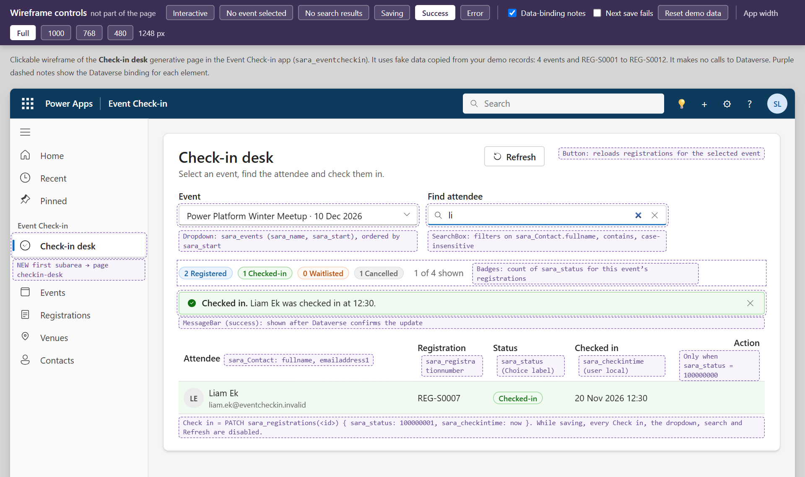
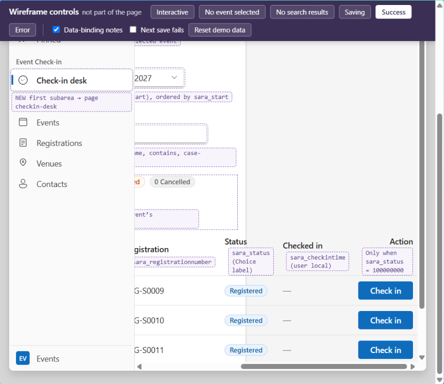
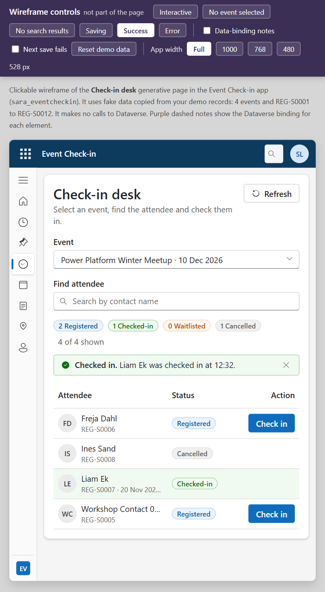
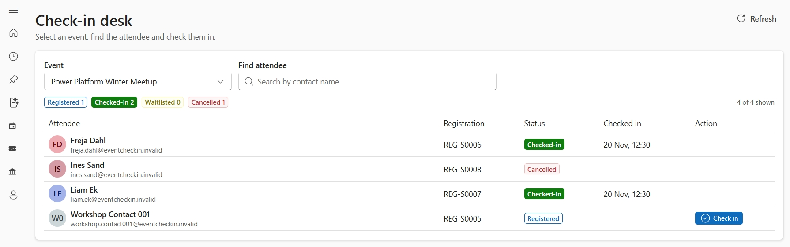
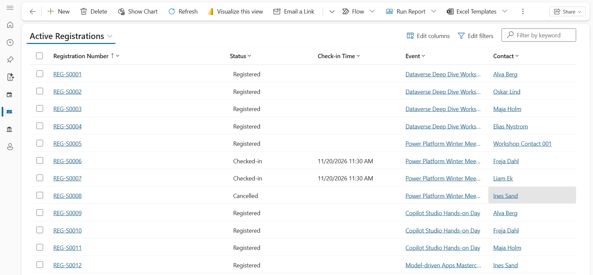

# Lab 3b — Build a Check-in desk generative page

**Time:** 25 minutes
**Goal:** use `/model-apps:genpage` to build, deploy and test a working page inside the existing Event Check-in model-driven app.

> **Why genpage and not app-builder?** `/model-apps:app-builder` builds or changes a whole app: tables, forms, views and navigation. `/model-apps:genpage` adds a single generative page to an app that already exists, and places it in that app's navigation. That is what this lab does.

You finish with a **Check-in desk** navigation entry where staff can select an event, find a registration and check in an attendee using live Dataverse data.

## Before you start

- Complete [Lab 3](lab-03-event-checkin-icons.md), including the icons and sample data.
- Keep the same `UG Workshop` folder open, with the **model-apps** plugin enabled and your workshop environment sign-ins available.
- Use the existing Event Check-in tables and the demo data created in Lab 3 Part C.
- The model-driven app must have been published once, as in Lab 3 Part A.

## Part A — Describe the page, refine the wireframe and review the plan (10 min)

1. In GitHub Copilot Chat, select **Agent** mode.
2. Ask:

   > /model-apps:genpage Add a working generative page called "Check-in desk" to the existing Event Check-in app in my workshop developer environment. Use the existing event-checkin folder in this workspace and inspect the deployed app and its schema first.
   >
   > Staff should select an event, search its registrations by contact name and see each attendee's registration status. Make finding an attendee the main action after selecting the event.
   >
   > Add a Check in action for Registered registrations. Save the status as Checked-in and record the current check-in time using the existing columns and actual Choice values. Already checked-in, waitlisted and cancelled registrations must not offer that action. Show saving, success and error states, and prevent repeated submissions while saving.
   >
   > Use live Dataverse data, not mocks. Reuse the existing tables, relationships and demo records; do not generate or reload sample data. Keep the existing icons, forms, views and navigation entries, and add this page to the same app.
   >
   > Before you present the page plan or generate any code, create a clickable HTML wireframe of the Check-in desk page in event-checkin/check-in-desk-wireframes.html, for me to approve.
   >
   > Make it look like the page will look inside the model-driven app. Use the Fluent 2 design language that model-driven apps and generative pages use: Segoe UI, Fluent 2 colour, spacing, corner-radius and shadow tokens, and the app shell with the top app bar, the collapsible left navigation with the existing Event Check-in entries and Check-in desk selected, and the page area. Draw the page with the Fluent UI v9 components you plan to use in the generated page, such as Dropdown, SearchBox, Table or DataGrid, Badge, Button, Spinner and MessageBar, and list those components in the plan.
   >
   > Make it clickable with inline JavaScript and fake data copied from my existing demo records: selecting an event shows its registrations, typing in the search box filters by contact name, and Check in shows saving, then success, and turns the row Checked-in with no second Check in. Only Registered rows offer Check in. Add a small wireframe toolbar, clearly outside the app frame, to switch to the no event selected, no search results, saving, success and error states, and to toggle data-binding notes on each element.
   >
   > Keep it to one self-contained file with inline CSS and JavaScript, no external scripts, fonts or CDNs, and no calls to Dataverse. Open it in the VS Code integrated browser, then wait for me to approve the wireframe before you present the page plan. Do not generate or deploy anything until I approve the plan. Save the agreed design in event-checkin/check-in-desk-plan.md.

3. Open the wireframe in the VS Code integrated browser. GitHub Copilot may already have opened it in an editor tab with an address bar. If not, use one of these:
   - In **Explorer**, right-click **event-checkin → check-in-desk-wireframes.html** and select **Open in Integrated Browser**.
   - With the HTML file open in the editor, select the **Open in Integrated Browser** (globe) button in the editor toolbar, or right-click the file's editor tab and select **Open in Integrated Browser**.

   If you do not see **Open in Integrated Browser**, update VS Code, or right-click the file, select **Reveal in File Explorer** and open it in your web browser instead. After GitHub Copilot changes the file, select **Reload** in the integrated browser's address bar to see the update.

   Click through the wireframe: select an event, search for a contact, check in a Registered attendee and use the wireframe toolbar to view the other states.

   

   If GitHub Copilot presents the page plan or asks to build before you have approved the wireframe, select **No** or **Something else** and ask it to create the clickable HTML wireframe first.
4. Now drag the edge of the integrated browser to make it narrower. 👀 Notice anything? Where did the **Check in** buttons go? Off the screen! It's not responsive.

   5. Ask GitHub Copilot to fix it, and watch it work. Keep the integrated browser visible next to Chat, at a width where you can see the problem. If the integrated browser shows **Share with Agent** in its address bar, select it so GitHub Copilot can use the open page. Then ask:

   > The wireframe is not responsive. Make it adapt like the real model-driven app and the generated page will: the app frame fills the window, the left navigation collapses to icons below about 1000 px and never covers the page, the attendee list stays readable without scrolling sideways (hide or wrap less important columns), the page has its own scroll area, and the wireframe toolbar never covers the app bar. Use flexbox and relative units. Test it in the integrated browser I have open, at several widths from narrow to wide, and fix what you find. Then update the plan.

   **Watch the integrated browser while GitHub Copilot works.** It edits the HTML, reloads the page, resizes it and inspects the result, then fixes what it sees and checks again. You see the same testing loop it will use later to verify the real page. When it finishes, drag the browser narrower and wider yourself to confirm.

      6. Open **Explorer → event-checkin → check-in-desk-plan.md** and check that the plan:
   - [ ] matches the clickable wireframe you reviewed, including its Fluent UI components, every page state and how it adapts to narrow widths;
   - [ ] adds a page to the existing **Event Check-in** app, rather than creating another app;
   - [ ] uses actual table and column names from your environment;
   - [ ] reads and updates live registrations, with no new sample data;
   - [ ] only allows Registered attendees to be checked in;
   - [ ] covers an empty list, no search results, saving and errors;
   - [ ] preserves the existing app components and places **Check-in desk** in navigation.
7. Request any other layout changes in the same chat and watch the integrated browser update again. When the wireframe looks right, reply:

   > I approve the wireframe. Present the page plan.

8. Review the page plan GitHub Copilot presents in Chat. It should add one page to the existing Event Check-in app and its navigation, reuse the existing tables and columns, and create no new tables or sample data. Do not approve it yet.

## Part B — Build and deploy the page (8 min)

1. In the same chat, approve the page plan. If GitHub Copilot shows a Yes/No question, select **Something else** and enter this reply:

   > Apply the agreed plan. Generate the page, deploy it into the existing Event Check-in app, publish the app and verify the result. Do not generate or reload sample data. Tell me the generated source file path, where to open the page in the app and anything verification could not confirm.

2. GitHub Copilot generates the page source, builds and deploys it, adds the navigation entry and publishes the app. Wait for its completion summary.
3. Open the generated source file from the changed-files list in Chat. You do not need to understand every line; ask GitHub Copilot to point out where the page reads registrations and where **Check in** saves the update.
4. Select **Keep** for the local files.
5. Open the **Event Check-in** app in [Power Apps](https://make.powerapps.com/) in your workshop environment. Refresh the browser and select **Check-in desk** in the app navigation.

> 🤖 **Copilot offers to test the page in a browser?** The model-apps plugin includes Playwright, so the agent can open its own browser and click through your page. That's cool to watch, but you'll need to sign in there yourself, and it changes real records. Do Part C yourself first, then let it try if you're curious.

## Part C — Test with the existing demo data (7 min)

1. Select an event that has registrations. Confirm the page shows its attendees and statuses.

   
2. Search for a contact name shown in the list. Confirm the matching registration appears. Try a name that does not exist and check the empty-state message.
3. Choose a **Registered** registration. Note its event and contact so you can find the same row again.
4. Select **Check in**. Confirm that the page shows success and the row changes to **Checked-in**, with no second check-in action.
5. Open the same row through the app's standard **Registrations** view. Confirm that **Status** is **Checked-in** and **Check-in Time** is populated. Refresh the page to confirm the change persisted.

   
6. Where the existing demo data includes Waitlisted or Cancelled registrations, confirm that they do not offer **Check in**.
7. Check that the original Events, Venues, Registrations and Contacts navigation entries still work and the Lab 3 table icons remain.
8. Describe any failed check in Chat, including what you did and what happened. Ask GitHub Copilot to fix and redeploy the page, then repeat the affected check.

> **Why check the standard form too?** A page can appear to update successfully while only changing its own display. Reading the same row in the standard app confirms that the change reached Dataverse.

## Done when

- [ ] **Check-in desk** opens from the existing Event Check-in app.
- [ ] The page reads the existing demo registrations from Dataverse.
- [ ] Checking in a Registered attendee updates Status and Check-in Time, confirmed in the standard registration form after a refresh.
- [ ] Already checked-in, waitlisted and cancelled registrations do not offer another check-in.
- [ ] The generated source is saved in your workspace, and the original app components still work.

## Troubleshooting

| Problem | What to do |
|---|---|
| GitHub Copilot cannot find the app or tables | Give it your workshop environment URL and ask it to inspect the existing Event Check-in app, as in Lab 3 Part B. |
| **Open in Integrated Browser** is missing, or the wireframe opens as code | Update VS Code to the latest version and try again from Explorer. Otherwise right-click the file, select **Reveal in File Explorer** and open it in your web browser. |
| GitHub Copilot skips the wireframe, or shows text wireframes only | Select **No** or **Something else**. Ask it to create the clickable Fluent UI wireframe in `event-checkin/check-in-desk-wireframes.html` and wait for your approval before it presents the page plan. |
| The wireframe does not look like the model-driven app | Ask GitHub Copilot to use Fluent 2 tokens and the model-driven app shell, with the top app bar and left navigation, and to draw the page with the same Fluent UI v9 components it will use in the generated page. |
| The plan uses invented column names or status values | Ask GitHub Copilot to check the actual schema and correct the plan. |
| The page is missing from navigation | Refresh the app. If it is still missing, ask GitHub Copilot to verify that the page is in the existing app's sitemap and that the app was published. |
| The page shows no registrations | Check that the selected event has registrations in the standard app, then ask GitHub Copilot to inspect the page's live query, lookup bindings and any reported access error. |
| Check-in looks successful, but the standard form has not changed | Ask GitHub Copilot to inspect the Dataverse update and surface any save error. A local display change is not a successful check-in. |
| Saving fails | Give GitHub Copilot the error shown on the page. Have it check the actual Choice values, update permissions and any plugin error before retrying. |
| A new browser window opens and asks you to sign in | That's the Playwright browser from the model-apps plugin, which the agent uses to test the page. Sign in yourself, and never paste your password into Chat. Or tell GitHub Copilot to skip browser testing; you test the page by hand in Part C anyway. |
