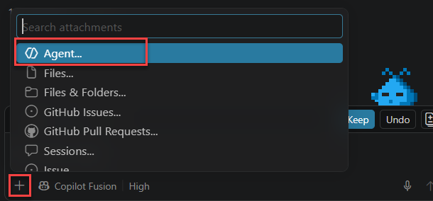
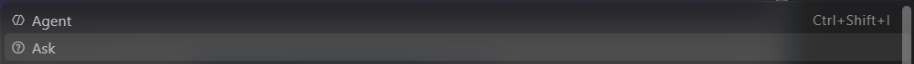
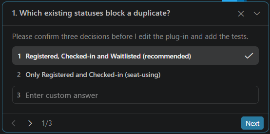
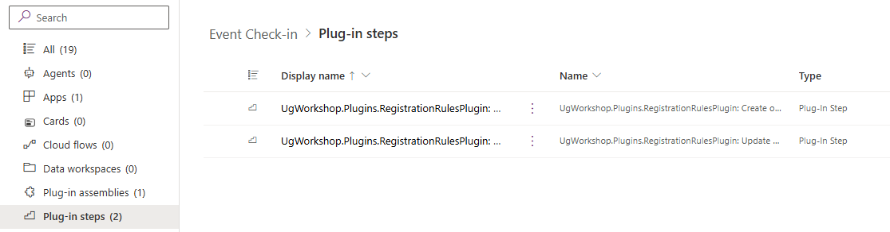
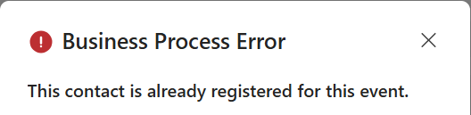
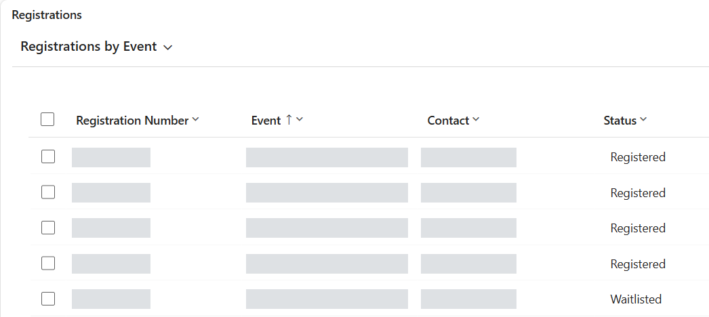

# Lab 4 — Your first Dataverse plugin: duplicate and capacity rules

**Time:** 40 minutes  
**Goal:** understand when synchronous server-side logic is appropriate, and let GitHub Copilot Chat write, build, test and register a small plugin while you review the plan and verify the result.

## Before you start

- You do everything in **GitHub Copilot Chat in VS Code**. GitHub Copilot runs the commands; VS Code may open a terminal panel to show the output.
- Download the **Lab 4 starter** [`lab-04-plugin.zip`](https://github.com/LagerquistSara/AIDevWS/raw/main/starter/lab-04-plugin.zip) from the workshop repository. Unzip it into your `UG Workshop` folder from Lab 2 and keep `UG Workshop` open in VS Code, so the MCP servers and sign-ins from Lab 2 still apply. The starter contains:

  | Folder or file | What it is |
  |---|---|
  | `README.md` | What is in the starter and the rules GitHub Copilot should follow, including the schema values the plugin uses. |
  | `UgWorkshop.Plugins.slnx` | The solution that GitHub Copilot builds and tests. |
  | `src/UgWorkshop.Plugins/` | An empty, signed plugin project with the class `RegistrationRulesPlugin`, created from the Power Platform CLI plugin template (`pac plugin init`). The signing key `UgWorkshop.Plugins.snk` is public and only for this workshop; create your own for real projects. |
  | `tests/UgWorkshop.Plugins.Tests/` | An empty NUnit test project with small in-memory fakes for Dataverse in `Fakes/`, so the tests run on Windows and macOS without extra packages. |

- Work only in your **disposable, non-production** workshop environment.

### Registration card

These values match the Event Check-in solution you imported in Lab 3.

| Setting | Expected value |
|---|---|
| Assembly | `UgWorkshop.Plugins` |
| Plugin type (class) | `UgWorkshop.Plugins.RegistrationRulesPlugin` |
| Table (primary entity) | `sara_registration` |
| Columns used | `sara_event`, `sara_contact`, `sara_status` |
| Steps | Create and Update, **PreOperation**, **Synchronous** |
| Update filtering attributes | `sara_event`, `sara_contact`, `sara_status` |
| Pre-image (Update step only) | name and alias `PreImage`, same three columns |
| Solution | `EventCheckIn` |

## Scenario

For a Registration, block a second active registration for the same Contact and Event. If an event appears full, mark a new Registration as Waitlisted. For this exercise, “active” means Registered or Checked-in; Cancelled and Waitlisted rows do not consume capacity. Only new registrations are waitlisted automatically: changing an existing Waitlisted or Cancelled registration back to Registered when the event is full shows an error instead.

## Important design boundary

A synchronous PreOperation plugin runs in the Dataverse transaction and can reject or modify the incoming row. A simple query-and-count implementation is useful for a sequential workshop demo, but **it is not a concurrency-safe seat reservation system**: two simultaneous transactions can both observe the last seat. Do not use this exercise as a production booking design without an explicitly reviewed concurrency strategy, performance analysis, and tests.

> **Teaching-only note.** In production, make the check safe by serializing on the parent Event. For example, update the Event row first in the same transaction, so a second registration for that event waits for the first. Then count all relevant registrations, whatever the calling user can see. The lab code skips this step to keep the exercise short.

## Part A — Compare approaches in Ask mode (8 min)

1. Start a **new chat** with the **+** at the top of the Chat view. Lab 3's long conversation would only distract GitHub Copilot here, and your workspace instructions still apply in the new chat.
2. Select the **+** at the bottom left of the chat box, choose **Agent…**, and then choose **Ask**. Ask mode answers questions without making changes, which is all you need for a discussion.

   

   

   Then ask:

   > Compare a business rule, Power Automate, and a synchronous Dataverse plugin for preventing duplicate Event/Contact registrations and assigning a waitlist status. State assumptions, transaction timing, and risks. Recommend an approach, but do not create files, run commands or register anything.

3. Review the response. Check that it separates duplicate detection from capacity enforcement and mentions the concurrency limitation.

## Part B — Write, build and test with GitHub Copilot (12 min)

1. Stay in the same chat. Select the **+** at the bottom left of the chat box, choose **Agent…**, and then choose **Agent**. Then ask:

   > Inspect this plugin starter and the Event Check-in schema. Propose the smallest implementation and unit tests for duplicate active registrations and sequential capacity handling, using PreOperation on Registration Create, and on Update only when Event, Contact or Status changes, with a pre-image named PreImage. Explain which statuses count and how the update path avoids counting the current row. Show me the plan before you edit any files.

   > **Why Agent now, if this is still planning?** Copilot can inspect the starter and your schema, then implement the plan in the same chat. Ask mode can inspect files too, but Agent can make the changes. Review its plan and proposed actions before allowing it to proceed.

2. GitHub Copilot may ask you a few questions before it starts. The questions can differ from person to person, but the answers are already in this lab: use the [Scenario](#scenario) and the registration card. **Don't just accept the recommended answer** — check it. For example:

   | If GitHub Copilot asks… | Answer |
   |---|---|
   | Which statuses block a duplicate? | Only **Registered** and **Checked-in**. Waitlisted and Cancelled do not count. |
   | What happens when an existing registration is changed back to Registered and the event is full? | Show an error that the event is full. Only *new* registrations are waitlisted automatically. |
   | Approve the plan and start implementing? | **No**, not yet. Review the plan first (step 3). |

   

   **Spot the trap:** in this example, the recommended first answer is selected. For this lab, choose the second answer instead.

   If the question you get isn't in the table, find the answer in the Scenario or the registration card. If you can't find it, ask the facilitator.

3. Review the plan against the registration card: table and column names, message, stage, filtering attributes and the error message text. Ask GitHub Copilot to correct anything that differs. Then reply *“Go ahead and implement it.”*
4. Sit back and watch. GitHub Copilot now does three things on its own:
   - **Writes the rules** into `RegistrationRulesPlugin.cs` and writes the **tests**: small automatic checks such as "the same person registering twice must be blocked".
   - **Builds** the code (`dotnet build`). This turns the code into the file that Dataverse will run later. The first time can take a minute.
   - **Runs the tests** (`dotnet test`) on a pretend Dataverse. Nothing in your environment changes. If a test fails, Copilot fixes the code and runs them again.

   Wait until it says that the build succeeded and **all tests passed**. If it didn't build or run the tests, ask: *"Build the solution and run the unit tests."*

   > **Stuck?** If Copilot still has failing tests after a few attempts, don't lose your lab time on it. Download the finished code [`lab-04-solution.zip`](https://github.com/LagerquistSara/AIDevWS/raw/main/starter/lab-04-solution.zip), unzip it over your `lab-04-plugin` folder, and continue with Part C.

5. Now make sure you understand what was tested. Ask: *"List each test in plain language: what situation does it try, and what should happen?"* Compare the answers with the [Scenario](#scenario). Is anything missing?

## Part C — Register with GitHub Copilot (10 min)

Registering a plugin means creating a few records in Dataverse: the **plug-in assembly** (your built DLL), the **plug-in type** (your class), one **step** per message and the **image**. The Plugin Registration Tool creates them with clicks; here GitHub Copilot creates them through the Dataverse Web API, inside the Event Check-in solution.

1. Ask:

   > I want to register this plugin in my workshop developer environment using the Dataverse Web API and my Azure CLI sign-in. First, write the registration as a file called plugin-registration.json in this workspace. Include the workshop environment URL; if you cannot determine it, ask me instead of guessing. Use these settings: assembly UgWorkshop.Plugins; plugin type UgWorkshop.Plugins.RegistrationRulesPlugin; table sara_registration; two steps, Create and Update, both PreOperation and Synchronous; the Create step has no filtering attributes; the Update step has filtering attributes sara_event, sara_contact and sara_status, and a pre-image named PreImage with those same three columns; solution EventCheckIn. Explain each setting in plain language. Do not register anything yet.

   The settings in the prompt come from the [registration card](#registration-card) at the top of this lab.

2. **Check the plan before anything goes into Dataverse.** `plugin-registration.json` is the plan for connecting your plugin to Dataverse: which table it watches, when it runs and which environment it goes to. Nothing has been registered yet, so this is your last chance to catch a mistake cheaply. A wrong setting here can make the plugin run at the wrong moment, never run at all, or end up in the wrong environment.

   Open `plugin-registration.json` from the changed files in Chat. It's a text file with settings in it; you don't need to understand every line. Use GitHub Copilot's explanation, or search the file with **Ctrl+F** / **Cmd+F**, and tick off each item:

   | Check | Why it matters |
   |---|---|
   | ☐ The environment URL is your **workshop** environment, not production. | The plugin will block and change registrations. You only want that in your test environment. |
   | ☐ The table is `sara_registration`. | That's the table the plugin protects. |
   | ☐ Both steps are **PreOperation** and **Synchronous**. | The plugin must run *before* the row is saved, and while the user waits, so it can stop a duplicate or set Waitlisted. |
   | ☐ The **Create** step has no filtering attributes. | Every new registration must be checked. |
   | ☐ The **Update** step has only `sara_event`, `sara_contact` and `sara_status` as filtering attributes. | The plugin only runs when one of these changes, not on every small edit. |
   | ☐ There's a pre-image called `PreImage` on the **Update** step only. | On an update, the plugin needs to see the values from before the change. |
   | ☐ The solution is `EventCheckIn`. | The registration moves together with the rest of the app to other environments. |

   If something is different, tell GitHub Copilot what's wrong and ask it to fix the file. When everything is ticked, select **Keep**.

3. Ask:

   > Register the plugin exactly as described in plugin-registration.json. Add every component to the EventCheckIn solution with the MSCRM.SolutionUniqueName header. Check Microsoft Learn for the correct Web API tables and columns, and tell me what each request does before you run it.

4. GitHub Copilot registers the plugin in your workshop environment.
5. Ask GitHub Copilot to summarise what it created: one assembly, one plugin type, two steps and one image, all in the Event Check-in solution.
6. Check in the browser: in [Power Apps](https://make.powerapps.com/), open **Solutions → Event Check-in**. Under **Objects**, look for **Plug-in assemblies** and **Plug-in steps**.

   

> **Why a registration file?** It documents exactly how the plugin is registered, so you or GitHub Copilot can repeat or remove the registration later — in this environment or another one — without guessing.

## Part D — Test in the app (10 min)

1. Open the Event Check-in app in [Power Apps](https://make.powerapps.com/) in the same environment.
2. Test sequentially:
   - Create a Registration; confirm it is Registered.
   - Create the same Contact/Event combination again; confirm a clear error message. In the error dialog, select **Show details** (or **Download log file**) to see the plugin's message.

     

   - Add registrations until the event reaches capacity; confirm the next row is Waitlisted.

     

     In this example, the event has four places. Names and other registration details are hidden.

   - **Notice what happens when capacity changes.** Note the event's current capacity and number of Registered attendees. Edit the Event, lower its capacity below that number, and save it. The change is allowed: this lab's plugin watches Registration rows, not changes to an Event. Restore the original capacity afterward; do not change any registrations.

     **Discuss, don't build:** In Ask mode, ask GitHub Copilot: *“What would need to be checked when an Event's capacity is lowered below its number of Registered attendees? Which table change would need to trigger that check, and what business decision is needed for attendees who are already Registered? Explain only; don't change files or Dataverse.”* You can build it later in [optional Lab 7](lab-07-challenges.md).

   - Change or cancel a registration and check the documented count behaviour.
3. If something behaves differently, describe what you did and what you saw in Chat so GitHub Copilot can diagnose, fix and retest it.
4. In Chat, open the changed files listed under GitHub Copilot's answers (code, tests and `plugin-registration.json`), check that there are no passwords, tokens or secrets, and select **Keep**.
5. Ask GitHub Copilot to explain the design in plain language: *“Why does the plugin run in PreOperation, why does the Update step need a pre-image, which statuses count toward capacity, and what happens if two people register for the last seat at the same time?”*

## Done when

You have reviewed the generated implementation and passing tests, checked `plugin-registration.json` against the card, approved the registration, and demonstrated the sequential duplicate scenario in the workshop environment.

## Troubleshooting

| Problem | What to do |
|---|---|
| GitHub Copilot types the command but nothing runs | Check that **Agent** mode is selected and look in Chat for the **Allow** button. |
| Build fails with a missing SDK | Check that the .NET 10 SDK is installed (Lab 0, section 3), then restart VS Code. |
| Tests keep failing | Use the finished code `lab-04-solution.zip` from the workshop repository; do not let GitHub Copilot weaken the tests to make them pass. |
| Azure CLI says you are not signed in | Ask GitHub Copilot to sign you in again with `az login`, as in Lab 2, then continue. |
| A request returns *403* or *not authorized* | You need the System Administrator or System Customizer role in the environment. Check that the requests use your workshop environment. |
| `sara_registration` is not found | The Event Check-in solution is not imported in this environment, or `plugin-registration.json` points to another environment. Check Lab 3 and the URL. |
| Saving a Registration shows an unexpected error | Remove the plugin as described below, then ask the facilitator. |

## Rollback: remove the plugin after the workshop

When you are finished — or if the plugin blocks your work — ask GitHub Copilot:

> Remove the plugin registration described in plugin-registration.json from my workshop environment: the image, the steps, the plugin type and the assembly, in that order. Tell me what each request does before you run it.

After GitHub Copilot removes the registration, create a Registration in the app to confirm that saving works normally again.

Do not register against production or an environment you do not own.
